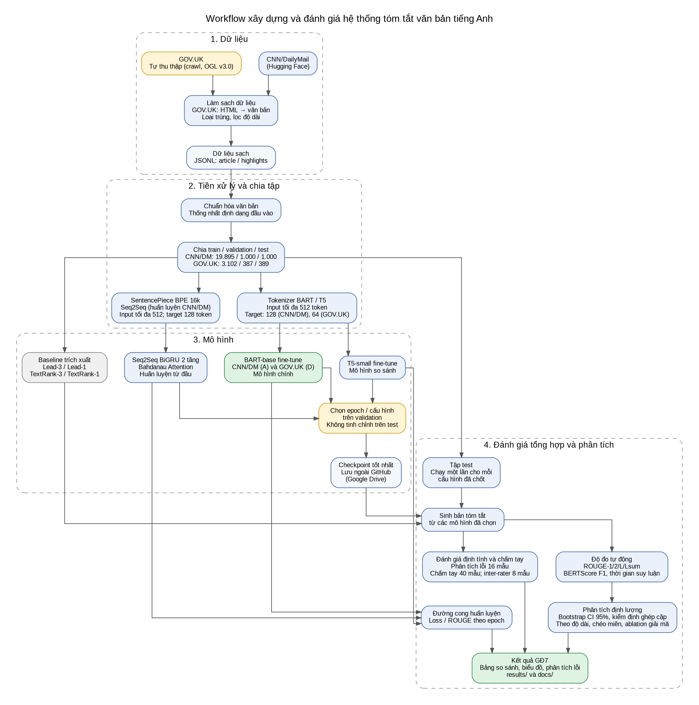

# Hệ thống tóm tắt văn bản tiếng Anh

Bài tập lớn học phần **Xử lý ngôn ngữ tự nhiên** – Đề tài: *Xây dựng hệ thống tóm tắt văn bản tiếng Anh*.

> Trạng thái: xem [Tiến độ](#tiến-độ)

## 1. Bài toán
- **Đầu vào:** một bài văn bản tiếng Anh (ví dụ: bài báo tin tức).
- **Đầu ra:** bản tóm tắt ngắn, giữ ý chính (abstractive).
- **Hướng tiếp cận:** so sánh baseline extractive (Lead-3, TextRank) với mô hình sinh (Seq2Seq+Attention, BART, T5).

## 2. Workflow tổng thể


## 3. Dữ liệu
| Nguồn | Vai trò | Ghi chú |
|---|---|---|
| CNN/DailyMail (HuggingFace) | Huấn luyện + đánh giá chính |287k/13k/11k mẫu gốc; dùng tập con 20k/1k/1k, seed 42|
| Dữ liệu tự thu thập | Điểm cộng, kiểm tra tổng quát hóa |GOV.UK (OGL v3.0): 3.878 cặp, train/val/test = 3.102 / 387 / 389|

## 4. Cài đặt
```bash
git clone <url-repo>
cd text-summarization-nlp
python -m venv .venv
source .venv/bin/activate        # Windows: .venv\Scripts\activate
pip install -r requirements.txt
```

## 5. Cấu trúc thư mục
```
artifacts/    từ vựng SentencePiece (nhỏ, có commit); checkpoint nằm ngoài repo
configs/      cấu hình thí nghiệm (yaml)
data/         dữ liệu (raw/processed không commit)
src/          mã nguồn: crawl, preprocessing, baselines, models, train, evaluate
notebooks/    EDA, phân tích lỗi
results/      figures (đường cong hội tụ), tables, logs
docs/         workflow, decisions.md, báo cáo, slides
tests/        unit test
```

## 6. Kết quả

### Baseline không huấn luyện (Giai đoạn 4)

Đánh giá trên tập test. ROUGE là F1 (có stemming), BERTScore là F1 (roberta-large, có rescale), cả hai nhân 100. Độ dài tính bằng số từ. Số liệu đầy đủ (kèm khoảng tin cậy 95%) nằm trong `results/tables/`.

**CNN/DailyMail** (n = 1.000, tham chiếu trung bình 52,6 từ)

| Hệ thống | ROUGE-1 | ROUGE-2 | ROUGE-Lsum | BERTScore | Độ dài |
|---|---|---|---|---|---|
| Random-3 | 28,5 | 8,2 | 25,4 | 12,6 | 66,7 |
| TextRank-3 | 35,2 | 13,8 | 31,5 | 21,6 | 80,5 |
| **Lead-3** | **40,3** | **17,6** | **36,5** | **26,0** | 77,4 |
| Oracle-3 (cận trên, dùng tham chiếu) | 56,7 | 33,5 | 52,6 | 43,2 | 59,3 |

**GOV.UK** (n = 389, tham chiếu trung bình 21,3 từ)

| Hệ thống | ROUGE-1 | ROUGE-2 | ROUGE-Lsum | BERTScore | Độ dài |
|---|---|---|---|---|---|
| Random-1 | 19,5 | 4,1 | 14,7 | 17,0 | 28,3 |
| TextRank-1 | 24,8 | 8,1 | 18,5 | 22,6 | 42,6 |
| **Lead-1** | **33,1** | **15,0** | **25,5** | **30,0** | 36,6 |
| Oracle-1 (cận trên, dùng tham chiếu) | 43,1 | 23,6 | 34,7 | 40,1 | 29,9 |

Nhận xét ngắn: Lead-3 (CNN/DM) và Lead-1 (GOV.UK) là baseline extractive mạnh nhất, vượt TextRank và Random có ý nghĩa thống kê (kiểm định bootstrap ghép cặp, `results/tables/baselines_paired_tests.csv`). Đây là mốc cần vượt ở Giai đoạn 6. Chi tiết và hạn chế: xem `docs/decisions.md` (D8).

### Seq2Seq + Attention huấn luyện từ đầu (Giai đoạn 5)

BiGRU 2 tầng + attention cộng, 7,46 triệu tham số, từ vựng SentencePiece BPE 16k, huấn luyện trên 19.895 mẫu train CNN/DM (73 phút, Tesla T4); đường cong hội tụ: `results/figures/seq2seq_in512_loss.png`. Cấu hình giải mã chính: beam 4, chặn lặp trigram (xem D9).

**CNN/DailyMail** (n = 1.000)

| Hệ thống | ROUGE-1 | ROUGE-2 | ROUGE-Lsum | BERTScore | Độ dài | % lặp trigram |
|---|---|---|---|---|---|---|
| Seq2Seq, greedy | 27,6 | 8,5 | 25,5 | – | 40,1 | 70,2 |
| Seq2Seq, beam 4 | 31,5 | 12,1 | 29,0 | – | 41,2 | 56,5 |
| **Seq2Seq, beam 4 + chặn lặp** | **33,3** | **13,0** | **30,9** | **20,8** | 37,5 | 2,2 |
| Lead-3 (baseline) | 40,3 | 17,6 | 36,5 | 26,0 | 77,4 | – |

**GOV.UK** (n = 389, chéo miền: huấn luyện trên CNN/DM)

| Hệ thống | ROUGE-1 | ROUGE-2 | ROUGE-Lsum | BERTScore | Độ dài | % lặp trigram |
|---|---|---|---|---|---|---|
| Seq2Seq, greedy | 21,2 | 5,9 | 17,7 | – | 38,8 | 60,7 |
| Seq2Seq, beam 4 | 23,6 | 7,7 | 19,1 | – | 41,1 | 45,8 |
| **Seq2Seq, beam 4 + chặn lặp** | **24,9** | **8,0** | **20,3** | **14,3** | 37,4 | 2,6 |
| Lead-1 (baseline) | 33,1 | 15,0 | 25,5 | 30,0 | 36,6 | – |

Nhận xét ngắn: Seq2Seq từ đầu thấp hơn Lead-3 (CNN/DM) và Lead-1 (GOV.UK) có ý nghĩa thống kê (`results/tables/seq2seq_paired_tests.csv`). Chặn lặp trigram giảm lỗi lặp từ 56–70% xuống khoảng 2% và tăng ROUGE-1 1,3–1,8 điểm so với beam 4 không chặn. Đây là mốc "từ đầu" để đối chiếu với BART/T5 ở Giai đoạn 6.

### GĐ6: tinh chỉnh BART-base và T5-small (tag v0.7-finetune)
 
Kết quả trên **tập test** (một lần chạy cho mỗi cấu hình đã chốt trên validation; CI 95% bằng bootstrap; thang ×100):
 
`results/tables/final_comparison_cnn_dm.md`
| Phương pháp | Họ | R1 | R2 | Lsum | BERTScore | Số từ TB | ms/bài |
|---|---|---|---|---|---|---|---|
| Lead-3 | Trích câu | 40.3 [39.6, 41.1] | 17.6 [16.9, 18.3] | 36.5 [35.8, 37.3] | 26.0 [25.3, 26.9] | 77.4 | 0 |
| TextRank-3 | Trích câu | 35.2 [34.5, 35.9] | 13.8 [13.1, 14.4] | 31.5 [30.8, 32.2] | 21.6 [20.7, 22.4] | 80.5 | 6 |
| Seq2Seq BiGRU + attention | Sinh, huấn luyện từ đầu | 33.3 [32.6, 34.0] | 13.0 [12.3, 13.7] | 30.9 [30.2, 31.7] | 20.8 [20.0, 21.8] | 37.5 | 111 |
| BART-base zero-shot | Tiền huấn luyện, chưa tinh chỉnh | 39.2 [38.5, 40.0] | 17.7 [17.0, 18.4] | 36.0 [35.3, 36.7] | 24.5 [23.8, 25.4] | 101.9 | 1314 |
| T5-small zero-shot | Tiền huấn luyện, chưa tinh chỉnh | 38.9 [38.2, 39.7] | 17.4 [16.6, 18.2] | 33.5 [32.7, 34.3] | 25.2 [24.4, 26.1] | 50.7 | 996 |
| BART-base tinh chỉnh (512, max_length 96) | Tinh chỉnh | 41.0 [40.3, 41.8] | 18.4 [17.7, 19.2] | 37.9 [37.2, 38.7] | 30.7 [29.9, 31.5] | 62.9 | 894 |
| BART-base tinh chỉnh (512, giải mã mặc định) | Tinh chỉnh | 40.8 [40.0, 41.5] | 18.4 [17.7, 19.2] | 37.7 [37.0, 38.5] | 30.6 [29.8, 31.5] | 69.3 | 1025 |
| BART-base tinh chỉnh (1.024, max_length 96) | Tinh chỉnh | 41.3 [40.6, 42.0] | 18.5 [17.7, 19.3] | 38.0 [37.3, 38.8] | 30.4 [29.6, 31.3] | 64.3 | 982 |
| T5-small tinh chỉnh (512) | Tinh chỉnh | 41.2 [40.5, 42.0] | 18.7 [17.8, 19.5] | 38.0 [37.3, 38.8] | 31.1 [30.2, 32.0] | 56.7 | 1163 |

`final_comparison_govuk.md`
| Phương pháp | Họ | R1 | R2 | Lsum | BERTScore | Số từ TB | ms/bài |
|---|---|---|---|---|---|---|---|
| Lead-1 | Trích câu | 33.1 [31.3, 34.7] | 15.0 [13.3, 16.7] | 25.5 [23.8, 27.1] | 29.9 [28.0, 31.7] | 36.6 | 0 |
| TextRank-1 | Trích câu | 24.8 [23.5, 26.0] | 8.1 [7.0, 9.1] | 18.5 [17.4, 19.5] | 22.6 [21.1, 24.1] | 42.6 | 6 |
| Seq2Seq (chéo miền: huấn luyện CNN/DM) | Sinh, huấn luyện từ đầu | 24.9 [23.6, 26.0] | 8.0 [7.0, 8.9] | 20.3 [19.1, 21.4] | 14.3 [12.9, 15.8] | 37.4 | 106 |
| BART-base huấn luyện CNN/DM (chéo miền) | Tinh chỉnh (chéo miền) | 27.4 [26.4, 28.6] | 10.1 [9.1, 11.0] | 22.5 [21.6, 23.5] | 20.0 [18.5, 21.5] | 48.8 | 694 |
| BART-base tinh chỉnh trên GOV.UK | Tinh chỉnh | 40.7 [38.8, 42.5] | 20.9 [18.9, 23.0] | 33.5 [31.6, 35.3] | 40.7 [38.9, 42.5] | 21.7 | 360 |
 
Đường cong hội tụ: `results/figures/hf_curves_cnn_dm.png`, `results/figures/hf_curves_govuk.png`.
Kiểm định ghép cặp: `results/tables/hf_paired_tests_*.csv`; điểm theo độ dài bài: `results/tables/hf_by_length_*.csv`;
ablation giải mã: `results/tables/decode_selection_*.csv`; chi tiết quyết định và dự đoán so với kết quả: `docs/decisions.md` (D10).

**Quyết định mô hình chính (D4):** chọn A (BART-base, `max_input=512`, lr `5e-5`, epoch tốt nhất 2; giải mã beam 4, chặn lặp trigram 3, `max_length=96`) cho CNN/DM. A hơn Lead-3 có ý nghĩa ở bốn chỉ số nhưng mức hơn ROUGE nhỏ (R1 +0,70 điểm); T5-small có điểm thô nhỉnh hơn A nhưng không khác biệt có ý nghĩa ở các chỉ số, nên không thể kết luận BART tốt hơn T5 về chất lượng. A được giữ theo quy tắc hòa đã khai báo trên validation và chi phí thực nghiệm thấp hơn trong cấu hình đã chạy. Với GOV.UK, dùng D (BART-base fine-tune trực tiếp trên GOV.UK); mô hình A chuyển miền không vượt Lead-1. Lý do và hạn chế chi tiết: [docs/decisions.md – D4](docs/decisions.md#d4-mô-hình-chính-bart-base-so-sánh-với-t5-small-seq2seqattention).

Checkpoint (không nằm trong GitHub): Google Drive, thư mục `checkpoints/{run_name}/best.pt`
(bart_cnndm_in512, bart_cnndm_in1024, bart_cnndm_in512_lr3e5, bart_cnndm_in512_lr1e4, t5small_cnndm_in512, bart_govuk_in512).

Tái lập (Colab T4; thay đường dẫn Drive):
 
    python -m src.data.hf_seq2seq_data --data_dir <clean> --cache_dir <hf_cache>            # token hóa + bảng số token
    python -m src.train_hf --config configs/bart_cnndm_in512.yaml --data_dir <clean> --cache_dir <hf_cache> \
        --ckpt_dir <checkpoints> --log_dir <logs>                                           # thêm --resume nếu bị ngắt
    python -m src.generate_hf --config configs/bart_cnndm_in512.yaml --zero_shot --split test ...   # mốc zero-shot
    python -m src.ablate_decode --key cnn_dm --ckpt_dir <checkpoints> ...                   # ablation giải mã (validation)
    python -m src.generate_hf --config ... --ckpt <best.pt> --split test <tham số đã chốt>  # test, một lần
    python -m src.analysis.compare_hf --data_dir <clean> --bertscore                        # kiểm định ghép cặp, theo độ dài bài
    python -m src.analysis.summarize_results ; python -m src.analysis.plot_hf_curves        # bảng tổng hợp, đường cong

*(Bảng so sánh BART-base/T5-small, tương quan chỉ số và phân tích lỗi được lưu trong `results/` và `results/gd7/`.)*

### GĐ7 – Đánh giá tổng hợp, phân tích lỗi và chấm tay

- **Tương quan ROUGE–BERTScore trên từng mẫu của toàn bộ test:** A trên CNN/DM có Spearman(S, BERTScore) = **0,849 [0,826; 0,868]**; D trên GOV.UK = **0,790 [0,743; 0,828]**. Với A, Spearman(R1, BERTScore) = 0,828 và Spearman(R2, BERTScore) = 0,807. Phạm vi: `results/tables/correlation_cnn_dm.csv/.md`, `results/tables/correlation_govuk.csv/.md`.
- **Phân tích lỗi định tính 16 mẫu:** thiếu thông tin/lựa chọn lệch trọng tâm ở 10/16; sai dữ kiện/ảo giác ở 2/16; đầu ra bị cắt cụt ở 1/16; 5/16 mẫu không phát hiện lỗi đáng kể. Nhãn có thể chồng lấp; đây là mô tả mẫu chọn có chủ đích, không phải tỷ lệ lỗi toàn test. Chi tiết: `results/gd7/error_analysis_annotations.md`.
- **Cờ tự động toàn test:** A có lặp trigram ở 3,2% mẫu CNN/DM; D là 0,77% trên GOV.UK. Trigram mới trung bình lần lượt là 13,4% và 29,7%. Cờ số/tên riêng không có trong bài xuất hiện ở 6,263% trong 990 mẫu CNN/DM có thực thể được phát hiện và 11,892% trong 370 mẫu GOV.UK có thực thể; đây chỉ là tín hiệu cần kiểm tra thủ công, không phải bằng chứng ảo giác. Các CSV cờ đã có `pred_words`, `ref_words`, `article_words`, `length_diff` và `length_ratio`; công thức hai cột mới được xác minh trên 1.000 mẫu CNN/DM và 389 mẫu GOV.UK, không phát hiện lỗi tính toán hay tham chiếu rỗng. Các file: `results/gd7/flags_*.csv`, `results/gd7/flags_summary_*.csv`.
- **Chấm tay lượt 1:** 40 mẫu (30 CNN/DM–A, 10 GOV.UK–D), một người chấm (Phạm Bá Hiếu), ba tiêu chí thang 1–5. Điểm trung bình: Fluency **3,78** [3,48; 4,05], Completeness **3,23** [3,00; 3,45], Factuality **4,50** [4,15; 4,83]. Do mẫu được phân tầng theo tứ phân vị S, các thống kê chỉ mô tả 40 mẫu đã chọn, không đại diện toàn bộ test. Báo cáo: `results/gd7/human_analysis.md`; dữ liệu: `results/gd7/human_summary.csv`, `results/gd7/human_correlations.csv`, `results/gd7/human_correlation_comparisons.csv`, `results/gd7/human_error_labels.csv`.
- **Liên hệ điểm chấm tay với chỉ số tự động:** Spearman(Completeness, BERTScore) = 0,373 [0,042; 0,616], so với Completeness–ROUGE-2 = 0,177 [-0,129; 0,444]; hiệu ghép cặp 0,196 [-0,049; 0,453] có CI chứa 0. Chưa có bằng chứng rõ rằng BERTScore tương quan với điểm đầy đủ cao hơn ROUGE-2 trên toàn bộ 40 mẫu.
- **Độ đồng thuận giữa hai người chấm trên 8 mẫu:** lượt 1 do Phạm Bá Hiếu, lượt 2 do một thành viên khác thực hiện. Người chấm lượt hai đã đọc rubric, chỉ được cung cấp bài gốc và tóm tắt, không được xem điểm/nhận xét lượt một trước khi chấm. QWK/Spearman lần lượt: Fluency 0,750/0,832; Completeness 0,684/0,717; Factuality 1,000/1,000. Có 18/24 cặp điểm trùng tuyệt đối (75%) và 24/24 cặp chênh không quá 1 điểm. Đây là inter-rater agreement trên n=8, chỉ mang tính mô tả/thăm dò; không phải test–retest của cùng người chấm. Phương án thực tế khác kế hoạch ban đầu (lượt hai được làm sớm và do người khác chấm), được ghi rõ trong D11.
- **Kết quả đóng GĐ7:** hoàn thành kiểm thử 183 test trên Google Colab,
  46 test thuộc các module phân tích GĐ7, kiểm tra dữ liệu và tài liệu.
  Đã commit và gắn tag v0.8-evaluation.

## Tiến độ
- [x] GĐ0: Khởi tạo repo, workflow v1, decision log - [`v0.1-setup`]
- [x] GĐ1: Dữ liệu công khai + EDA — [`v0.2-data`]
- [x] GĐ2: Tự thu thập dữ liệu — [`v0.3-custom-data`]
- [x] GĐ3: Pipeline tiền xử lý — [`v0.4-preprocessing`]
- [x] GĐ4: Baseline (Lead-3, TextRank) — [`v0.5-baselines`]
- [x] GĐ5: Seq2Seq + Attention— [`v0.6-seq2seq`]
- [x] GĐ6: Fine-tune BART / T5 — [`v0.7-finetune`]
- [x] GĐ7: Đánh giá + phân tích lỗi (D4, cờ độ dài và inter-rater 8 mẫu đã hoàn thành; còn kiểm tra trước commit và kiểm thử cuối)
- [-] GĐ8: Demo
- [x] GĐ9: Báo cáo (v0.9-report)
- [x] GĐ10: Slides (v1.0-final)
## Nhóm thực hiện
| Họ tên | Mã SV | Nhiệm vụ |
|---|---|---|
|Phạm Bá Hiếu|23010216|Điều phối, thiết kế phương pháp, đánh giá tổng hợp, phân tích lỗi và biên tập báo cáo|
|Nguyễn Phi Hùng|23010582|Thu thập, làm sạch, tiền xử lý và thống kê dữ liệu|
|Tiêu Hải Nam|23010214 |Xây dựng baseline, Seq2Seq và đánh giá mô hình|
|Lê Sơn Hải|23010007|Fine-tuning BART/T5, thiết kế thí nghiệm và ablation|
