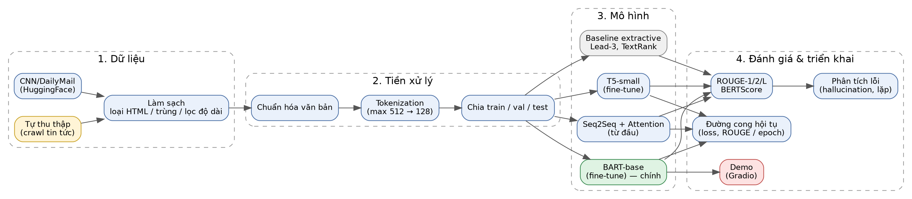

# Hệ thống tóm tắt văn bản tiếng Anh

Bài tập lớn học phần **Xử lý ngôn ngữ tự nhiên** – Đề tài: *Xây dựng hệ thống tóm tắt văn bản tiếng Anh*.

> Trạng thái: Giai đoạn 0 – Khởi tạo (xem [Tiến độ](#tiến-độ))

## 1. Bài toán
- **Đầu vào:** một bài văn bản tiếng Anh (ví dụ: bài báo tin tức).
- **Đầu ra:** bản tóm tắt ngắn, giữ ý chính (abstractive).
- **Hướng tiếp cận:** so sánh baseline extractive (Lead-3, TextRank) với mô hình sinh (Seq2Seq+Attention, BART, T5).

## 2. Workflow tổng thể


## 3. Dữ liệu
| Nguồn | Vai trò | Ghi chú |
|---|---|---|
| CNN/DailyMail (HuggingFace) | Huấn luyện + đánh giá chính | *(cập nhật ở Giai đoạn 1)* |
| Dữ liệu tự thu thập | Điểm cộng, kiểm tra tổng quát hóa | *(cập nhật ở Giai đoạn 2)* |

## 4. Cài đặt
```bash
git clone <url-repo>
cd text-summarization-nlp
python -m venv .venv
source .venv/bin/activate        # Windows: .venv\Scripts\activate
pip install -r requirements.txt
```

## 5. Cấu trúc thư mục
```
configs/      cấu hình thí nghiệm (yaml)
data/         dữ liệu (raw/processed không commit)
src/          mã nguồn: crawl, preprocessing, baselines, models, train, evaluate
notebooks/    EDA, phân tích lỗi
results/      figures (đường cong hội tụ), tables, logs
app/          demo
docs/         workflow, decisions.md, báo cáo, slides
tests/        unit test
```

## 6. Kết quả
*(cập nhật ở Giai đoạn 7)*

## Tiến độ
- [x] GĐ0: Khởi tạo repo, workflow v1, decision log
- [ ] GĐ1: Dữ liệu công khai + EDA
- [ ] GĐ2: Tự thu thập dữ liệu
- [ ] GĐ3: Pipeline tiền xử lý
- [ ] GĐ4: Baseline (Lead-3, TextRank)
- [ ] GĐ5: Seq2Seq + Attention
- [ ] GĐ6: Fine-tune BART / T5
- [ ] GĐ7: Đánh giá + phân tích lỗi
- [ ] GĐ8: Demo
- [ ] GĐ9–10: Báo cáo, slides

## Nhóm thực hiện
| Họ tên | Mã SV | Nhiệm vụ |
|---|---|---|
|Phạm Bá Hiếu|23010216| ... |
|Nguyễn Phi Hùng| ... | ... |
|Tiêu Hải Nam| ... | ... |
|Lê Sơn Hải| ... | ... |